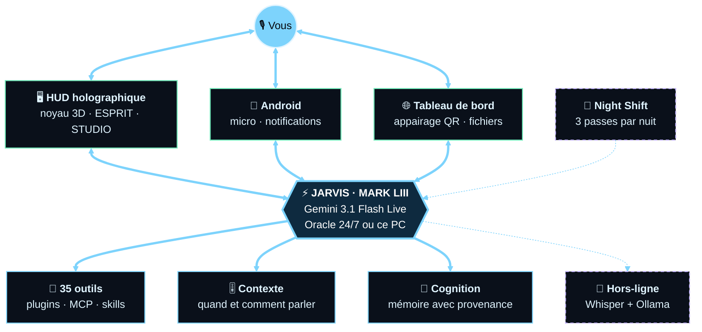
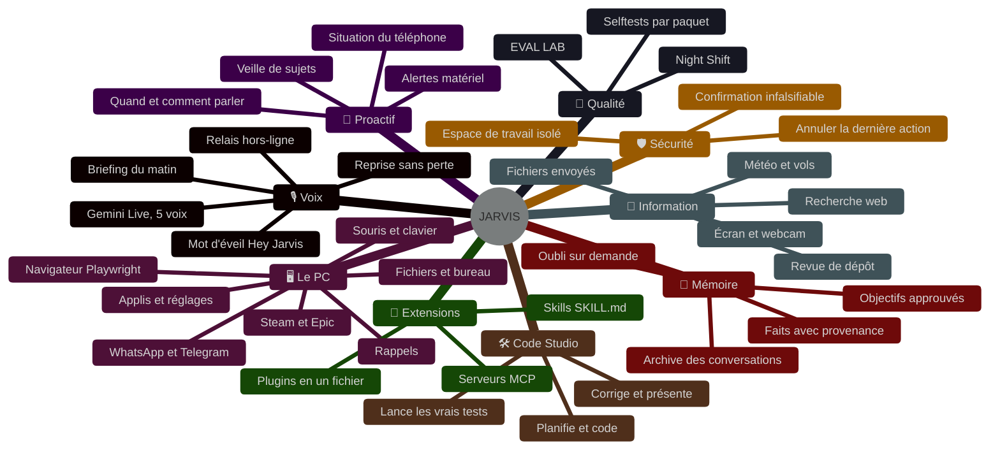

<p align="center">
  
</p>

<p align="center">
  
  
  
  <a href="https://github.com/TeddyDARKVADOR/Jarvis_replacement_new/actions/workflows/nightly.yml"></a>
</p>

<p align="center"><b>Un assistant vocal temps réel qui entend, voit, se souvient et agit</b><br>
le cerveau tourne 24 h/24 sur un serveur, le PC et le téléphone sont ses terminaux.</p>

---

## 🛰️ Comment c'est fait



## ✨ Ce qu'il sait faire



> JARVIS connaît son propre graphe : demandez-lui **« montre-moi ton graphe »**, il l'ouvre dans le HUD.
> Le détail de chaque fonctionnalité, avec son état vérifié, est dans [`capabilities/graphs/`](capabilities/graphs/).

## ⚡ Démarrer

```bash
git clone https://github.com/TeddyDARKVADOR/Jarvis_replacement_new.git
cd Jarvis_replacement_new
python setup.py            # les dépendances de votre OS, rien de plus
```

| Commande | Ce qui se lance |
|---|---|
| `python main.py` | le HUD, relié à JARVIS sur le serveur |
| `python main.py --local` | JARVIS entièrement sur ce PC, même HUD |
| `python main.py --mini` | le HUD réduit en orbe dans un coin |

**Premier lancement :** les Paramètres (⚙ ou `Ctrl+,`) s'ouvrent seuls. Entrez l'adresse du serveur et le jeton (`python -m server.run_headless --pairing` sur le serveur), ou, en `--local`, votre clé [Gemini](https://aistudio.google.com/apikey) gratuite.

**Il faut :** Python 3.11 ou 3.12, un micro, des haut-parleurs. Le mot d'éveil, Ollama et le serveur sont facultatifs.

## 🧪 Vérifier

Chaque paquet se prouve seul, sans clé ni réseau : `python -m capabilities.selftest`, `python -m context.selftest`, `python -m server.selftest`, …
La liste complète est dans [`CLAUDE.md`](CLAUDE.md). Trois fois par nuit, **Night Shift** relance les 15 suites sous Linux, mesure si JARVIS s'améliore et s'attaque à chaque passe à un problème différent : un correctif proposé, à relire, jamais fusionné par une machine.

## 📜 Licence

Basé sur **Mark LIII** de [FatihMakes](https://www.youtube.com/@FatihMakes).
Usage personnel et non commercial : [CC BY-NC 4.0](LICENSE).
