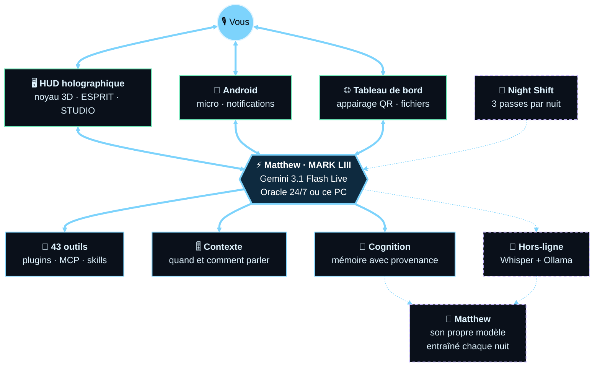
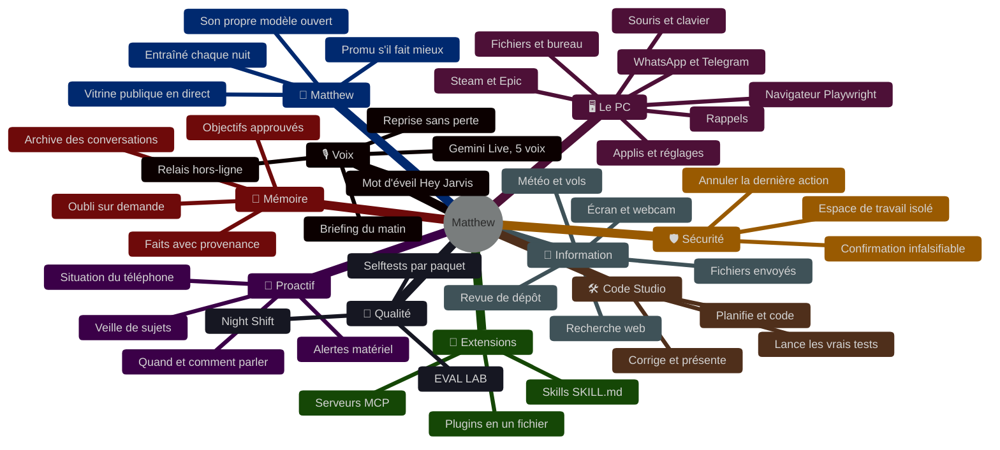
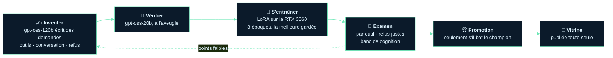

<p align="center">
  
</p>

<p align="center">
  
  
  
  <a href="https://github.com/TeddyDARKVADOR/Jarvis_replacement_new/actions/workflows/nightly.yml"></a>
</p>

<p align="center"><b>Un assistant vocal temps réel qui entend, voit, se souvient et agit</b><br>
le cerveau tourne 24 h/24 sur un serveur, le PC et le téléphone sont ses terminaux.</p>

---

## 🛰️ Comment c'est fait



## ✨ Ce qu'il sait faire



> Matthew connaît son propre graphe : demandez-lui **« montre-moi ton graphe »**, il l'ouvre dans le HUD.
> Le détail de chaque fonctionnalité, avec son état vérifié, est dans [`capabilities/graphs/`](capabilities/graphs/).

## ⚡ Démarrer

```bash
git clone https://github.com/TeddyDARKVADOR/Jarvis_replacement_new.git
cd Jarvis_replacement_new
python setup.py            # les dépendances de votre OS, rien de plus
```

| Commande | Ce qui se lance |
|---|---|
| `python main.py` | le HUD, relié à Matthew sur le serveur |
| `python main.py --local` | Matthew entièrement sur ce PC, même HUD |
| `python main.py --mini` | le HUD réduit en orbe dans un coin |

**Premier lancement :** les Paramètres (⚙ ou `Ctrl+,`) s'ouvrent seuls. Entrez l'adresse du serveur et le jeton (`python -m server.run_headless --pairing` sur le serveur), ou, en `--local`, votre clé [Gemini](https://aistudio.google.com/apikey) gratuite.

**Il faut :** Python 3.11 ou 3.12, un micro, des haut-parleurs. Le mot d'éveil, Ollama et le serveur sont facultatifs.

## 🔌 Nomade — Matthew sur clé USB

Matthew tient sur une clé USB et tourne depuis **n'importe quel PC Windows** (ou
Linux) **sans rien installer ni laisser sur l'hôte**. Branchez la clé, une fenêtre
demande *« Lancer Matthew sur ce PC ? »*, et un **réacteur ARC animé** s'affiche le
temps du démarrage ; retirez la clé, rien ne reste.

```
<clé>\JARVIS\
  Lancer-JARVIS.bat     double-clic : déploie et lance (anime le boot)
  app\                  le dépôt (copié par portable\sync_to_key.ps1)
  data\                 TOUT vit ici : home, caches, mémoire, modèles
  runtime\              Python portable + Ollama optionnel
```

- **Zéro trace, cœur intact** : le lanceur redirige `USERPROFILE`/`LOCALAPPDATA`/
  `APPDATA`/`TEMP`/`HF_HOME`/`OLLAMA_MODELS`… vers la clé avant de démarrer Python.
  Aucun fichier de `core/` n'est touché (contrat V2).
- **Plusieurs clés Gemini** : listez-les (`gemini_api_keys`) ou laissez le PC hôte
  injecter la sienne (`MATTHEW_ASSISTANT_GEMINI_KEYS`) — Matthew bascule quand l'une épuise son
  quota du jour. Plusieurs comptes ≈ plus de quota.
- **Coffre** : `portable\secure_key.ps1 -Action lock` chiffre vos clés (et votre
  mémoire) avec une phrase ; clé perdue = données illisibles. Compatible Ventoy.
- **100 % hors-ligne** : `portable\add_ollama.ps1` pose Ollama + un modèle outillé
  sur la clé ; Matthew marche alors sans internet ni Gemini.
- **Lancement au branchement** : `portable\autostart_watcher.ps1` (icône barre des
  tâches, sans trace) demande l'autorisation par une fenêtre élégante *Oui / Non* ;
  `install_autostart.ps1` l'automatise au logon sur vos PC de confiance.
- **Look & accessibilité** : réacteur ARC animé au boot (grille HUD, anneaux,
  particules, balayage radar) et extinction *power-down* au retrait ; thème d'accent
  au choix et mode **mouvement réduit** (`data\portable.json`, réglés par le wizard).
- **S'adapte au PC** : `host_profile.py` détecte GPU/RAM et choisit le modèle Ollama
  (RTX → `qwen3:8b`), mesure la vitesse de la clé, et bascule sur Ollama hors-ligne.
  Demandez *« fais le bilan portable »* → l'action `doctor` de l'outil `portable`.
- **Responsivité clé USB** : pas de `.pyc` écrits sur la clé, `cognition.db` chiffrable
  (checkpoint WAL propre), multi-clés actif pour **tous** les appels (voix, réunion,
  briefing…).
- **Continuité d'identité** : le même *moi* voyage avec la clé. Au branchement, récap
  de reprise conscient de la machine — *« la dernière fois, sur le PC du bureau, on
  finissait X ; ici nouvelle machine, sans GPU → Ollama »* (`resume`, `note`).
- **Zéro-trace *prouvé*** : Matthew mémorise les vrais dossiers de l'hôte avant de
  rediriger, puis **démontre à l'arrêt que 0 fichier a été écrit hors de la clé**
  (`audit`). Chiffrement clés **+ mémoire** par défaut.
- **Increvable** : auto-vérification au boot (dépendance cassée → réinstallée
  seule) et contrôle d'**intégrité** de la clé (manifeste de hash) — action `check`.
- **Pratique** : conscience **batterie** (évite les gros modèles sur batterie),
  `history` (où/quand il a tourné), **éjection en sécurité** depuis l'icône du veilleur.

Tout le détail, avec l'état vérifié, est dans le graphe
[`capabilities/graphs/deployment.json`](capabilities/graphs/deployment.json) (nœud *Matthew portable*).

## 🌱 Matthew — un cerveau à lui

Matthew pense aujourd'hui avec Gemini. **Matthew** est la transition : un modèle aux poids
ouverts (Qwen3.5-4B, Apache-2.0) qui apprend chaque nuit sur **la carte graphique de la
maison**, et qui prend des tâches une à une, seulement quand l'évaluation prouve qu'il fait
aussi bien.



- **Chaque nuit à 02 h 30** (tâche Windows *Matthew flywheel*) : amorçage, entraînement,
  examen, promotion, vitrine. Il repart toujours du modèle de base, jamais de son propre
  candidat ; un meilleur modèle ouvert peut devenir sa base (« challengers »).
- **Jamais appris de Gemini ni de Claude** : leurs conditions l'interdisent. Les réponses
  modèles viennent de professeurs sous licence ouverte (gpt-oss via Groq ; qwen3.6 et gemma4
  en local quand le quota gratuit est épuisé) et de **vos corrections** — dites *« non, la
  bonne réponse c'était… »*, ou utilisez l'onglet **MATTHEW** du panneau ESPRIT.
- **Déjà en service** : Ollama le sert sous le nom `matthew` ; il répond quand Gemini est
  injoignable (relais hors-ligne) et fait les tâches de fond de la cognition s'il réussit son
  banc. Le badge du HUD dit qui répond : GEMINI, MATTHEW ou HORS-LIGNE.
- **Ses propres tokens** : `python -m matthew.gateway` — une API compatible OpenAI devant
  Ollama, une clé par appareil, un budget de tokens par jour, du streaming.
- **La vitrine** : [teddydarkvador.github.io/matthew-vitrine](https://teddydarkvador.github.io/matthew-vitrine/)
  — un récit qui défile sur une scène 3D : Matthew dans sa base sur la Lune, une lumière par
  savoir-faire, la frise de ses nuits, l'examen rejoué en direct, ses réponses avant / après,
  ses compteurs (tokens, heures de GPU, nuits), en français et en anglais. Lecture seule,
  aucune vraie conversation publiée ; elle se met à jour d'elle-même à chaque amélioration
  (crochets Git + boucle de nuit).
- **Où il en est** (21 octobre 2026) : deuxième champion, **90 %** à l'examen (85 % au
  premier), 91 % de refus justes quand aucun outil ne convient (50 % avant).

| Commande | Ce qu'elle fait |
|---|---|
| `python -m matthew.flywheel --status` | où en est Matthew |
| `python -m matthew.flywheel --execute` | un cycle complet, maintenant |
| `python -m matthew.vitrine publish` | republier la vitrine |
| `python -m matthew.gateway key create telephone` | une clé pour un appareil |

Le détail, la vision à 10 ans et l'état vérifié de chaque pièce sont dans le graphe
[`capabilities/graphs/matthew.json`](capabilities/graphs/matthew.json).

## 🧪 Vérifier

Chaque paquet se prouve seul, sans clé ni réseau : `python -m capabilities.selftest`, `python -m context.selftest`, `python -m server.selftest`, …
La liste complète est dans [`CLAUDE.md`](CLAUDE.md). Trois fois par nuit, **Night Shift** relance les suites sous Linux, mesure si Matthew s'améliore et s'attaque à chaque passe à un problème différent : un correctif proposé, à relire, jamais fusionné par une machine.

## 📜 Licence

Basé sur **Mark LIII** de [FatihMakes](https://www.youtube.com/@FatihMakes).
Usage personnel et non commercial : [CC BY-NC 4.0](LICENSE).
